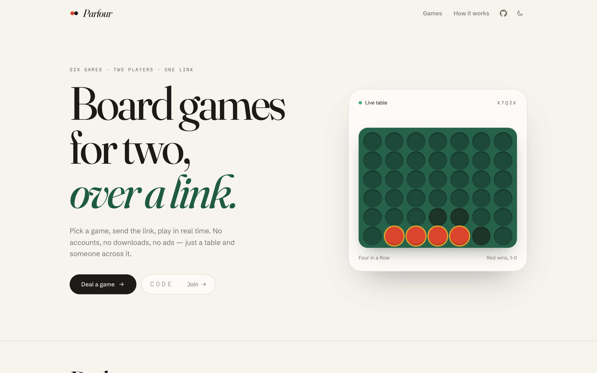
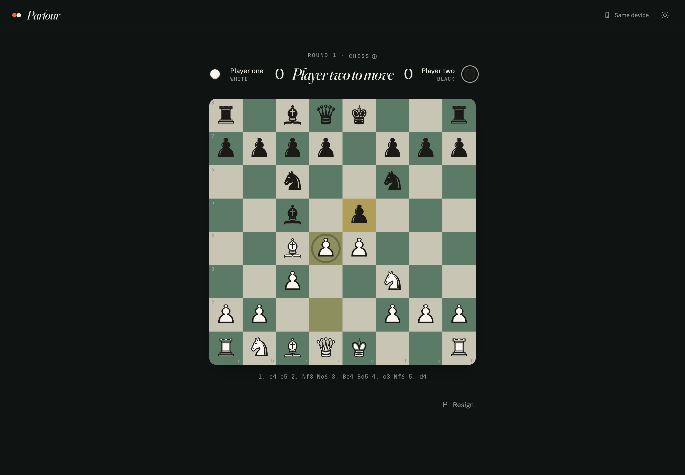
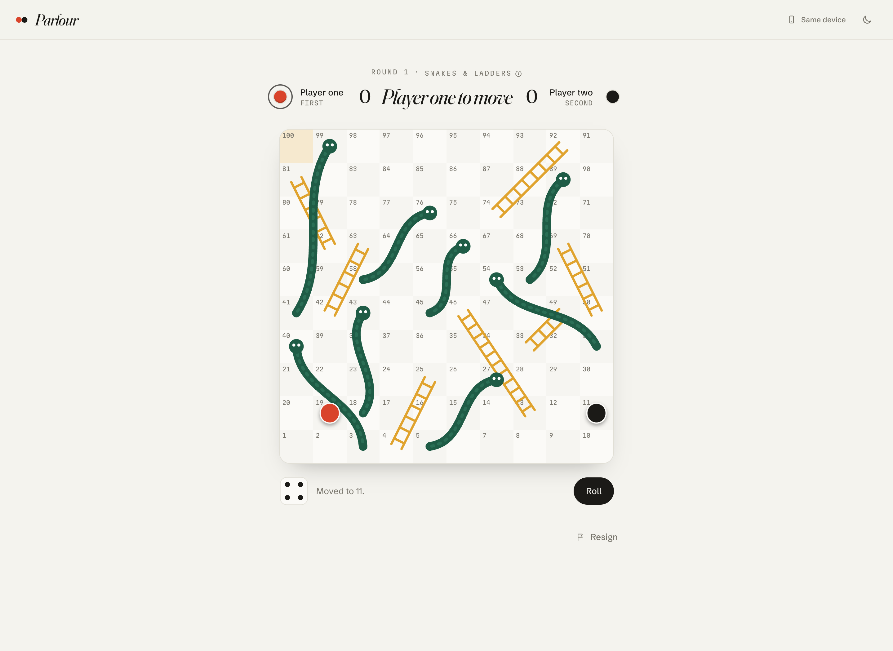
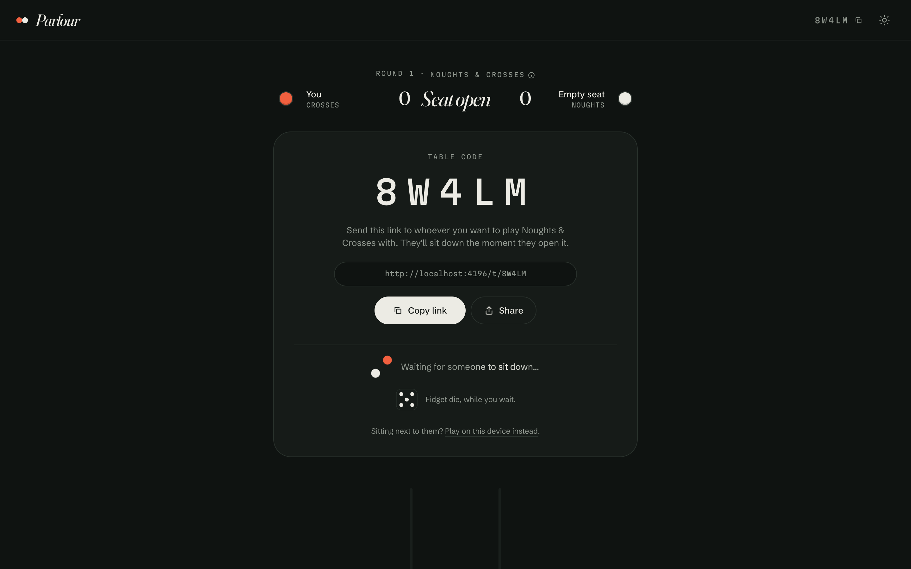
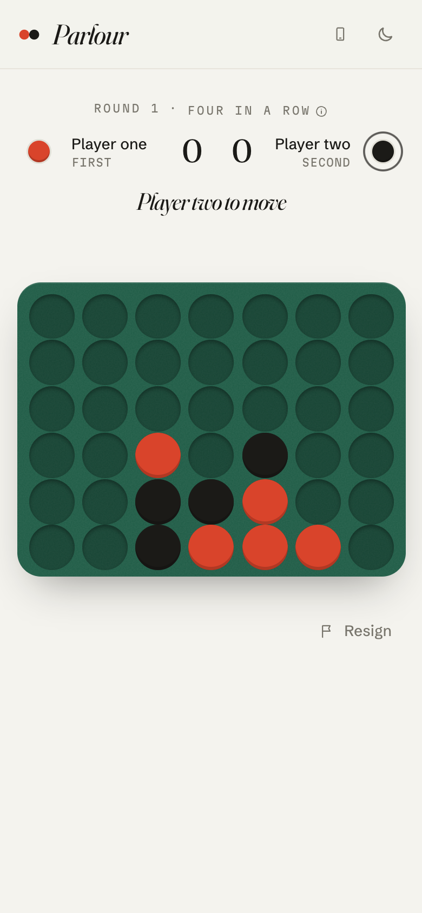

<div align="center">

# Parlour

**Board games for two, over a link.**

Pick a game, send the link, play in real time. No accounts, no downloads, no ads.

[playparlour.vercel.app](https://playparlour.vercel.app) · [playparlour.web.app](https://playparlour.web.app)



</div>

## The games

| | Game | What it is |
|---|---|---|
| 01 | **Noughts & Crosses** | Three in a line. Crosses go first. |
| 02 | **Four in a Row** | Drop discs into seven columns; line up four. |
| 03 | **Dots & Boxes** | Draw lines on a 6×6 grid of dots. Close a box and go again. |
| 04 | **Reversi** | Outflank and flip. Turns pass automatically when you have no move. |
| 05 | **Chess** | Full rules via [chess.js](https://github.com/jhlywa/chess.js): castling, en passant, promotion, checkmate, stalemate, repetition and the 50-move rule. |
| 06 | **Snakes & Ladders** | A hundred squares, seven ladders, eight snakes. A six rolls again; land exactly on 100. |

<p>
  
  
</p>

## How it plays

- **Play online** opens a table with a five-letter code (`/t/K7Q2X`). Whoever opens the link first takes the empty seat; anyone after that watches.
- **Same device** (`/here/chess`) is pass-and-play on one screen, with no network at all.
- Rounds keep a running score. **Play again** swaps who starts; you can also switch to another game at the same table.
- Moves are checked by the same rules engine on both sides and written in a Firestore transaction, so two quick taps can't both land.
- Small touches: the tab title and favicon change when it's your move and the tab is in the background, phones buzz on your turn, and there are five reactions that float up on both screens.

<p>
  
  
</p>

## Design

A card table: bone paper, baize green, card red and ink, in light and dark themes.

| Token | Light | Dark |
|---|---|---|
| Paper | `#F4F3EE` | `#0F1311` |
| Line | `#E1DFD6` | `#29312C` |
| Baize | `#1F5C46` | `#183F31` |
| Card red | `#D9442B` | `#F2603F` |
| Ink | `#1B1A17` | `#ECEBE4` |

Type is [Fraunces](https://fonts.google.com/specimen/Fraunces) for display, [Schibsted Grotesk](https://fonts.google.com/specimen/Schibsted+Grotesk) for text and [Martian Mono](https://fonts.google.com/specimen/Martian+Mono) for codes, all self-hosted through Fontsource. Chess pieces use a 6 KB cut of Noto Sans Symbols 2 containing only the twelve chess glyphs.

Where each design resource went:

- **[Coolors](https://coolors.co/f4f3ee-e1dfd6-1f5c46-d9442b-1b1a17)**: the palette above.
- **[Animista](https://animista.net)**: `text-focus-in`, `scale-in-center`, `puff-in-center`, `shake-horizontal` (illegal moves), `slide-in-bottom`, `flip-in-ver-right` (Reversi flips) and `heartbeat` (whose turn), in [`src/styles.css`](src/styles.css) under their Animista names.
- **[React Bits](https://reactbits.dev)**: `BlurText` (hero), `DecryptedText` (table code), `Magnet` (main buttons), `Counter` (scores) and `ClickSpark` (moves and wins), vendored in [`src/components/reactbits`](src/components/reactbits).
- **[21st.dev](https://21st.dev/community/components)**: ibelick's *Text Shimmer* (from the MIT [motion-primitives](https://github.com/ibelick/motion-primitives) repo) on the "waiting for someone to sit down" line.
- **[Uiverse](https://uiverse.io/elements)**: AqFox's two-dot orbit loader (two seats circling) and Yaya12085's pulse dot ("live table").
- **[Design Spells](https://www.designspells.com)**: the turn-aware tab title and favicon, haptics, floating reactions, the logo's two seats that swap places on hover, and a fidget die while you wait.
- **[minimal.gallery](https://minimal.gallery), [Awwwards](https://www.awwwards.com), [landing.love](https://www.landing.love)**: the numbered game index with a preview that follows the cursor, the oversized footer wordmark, and the large serif-on-paper layout.

## Built with

Vite 8, React 19, TypeScript 7, Tailwind CSS 4, Motion, chess.js and Firebase (anonymous Auth + Firestore). The landing page doesn't load Firebase: the SDK and each game's board are separate chunks that load when you sit down.

```
src/
  games/        rules.ts (five games) + chess.ts: pure, unit-tested rules
    boards/     one React board per game
    catalog.ts  names, rules text, lazy loaders
  lib/
    table.ts    the table model and its reducer (shared by online and same-device play)
    net.ts      Firebase: anonymous sign-in, create/join/act transactions, heartbeat
    spells.ts   tab title, favicon and haptics on your turn
  pages/        Landing, OnlineTable, HereTable, TableView
firestore.rules who can create, join and move at a table
```

## Run it

```bash
npm install
npm run dev        # http://localhost:5173
npm run check      # typecheck, tests, build
```

`npm run assets` re-renders the icons and social card, and `npm run screenshots` refreshes the images in this README (both use your installed Chrome via puppeteer-core).

### Your own Firebase project

1. Create a project, enable **Authentication → Anonymous** and create a **Firestore** database.
2. Put your web config in [`src/lib/net.ts`](src/lib/net.ts) and your project ID in `.firebaserc`.
3. `firebase deploy --only firestore` publishes the security rules and a TTL policy that deletes tables a week after their last move.

## Deploying

- **Vercel** builds from `main` automatically ([`vercel.json`](vercel.json) handles routing and caching).
- **Firebase Hosting**: `npm run deploy:firebase` builds and deploys to the `playparlour` site and updates the Firestore rules. The old `global-arcade-app.web.app` address redirects to the new one.

## History

Parlour was **Global Arcade**: a single-file React app with Tic-Tac-Toe, simplified chess and Snakes & Ladders. Version 2 is a rewrite: a new name and look, three new games, chess with full rules, same-device play, rematches with a running score, Firestore security rules (the old database ran in test mode, which had expired), and a landing page that loads without the Firebase SDK.

## Licence

MIT, see [LICENSE](LICENSE). React Bits components are MIT + Commons Clause; the chess glyphs come from Noto Sans Symbols 2 (SIL Open Font License).
